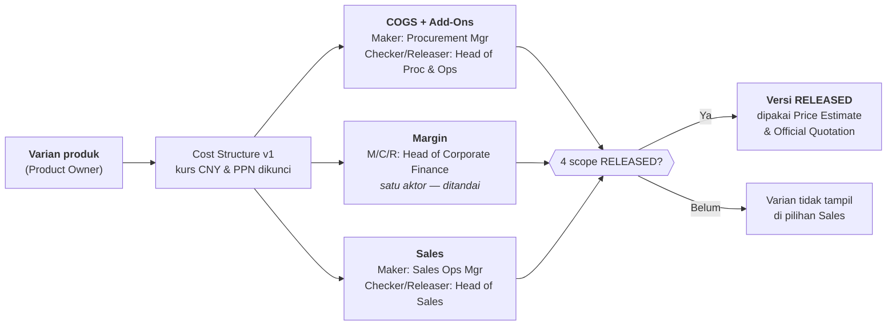
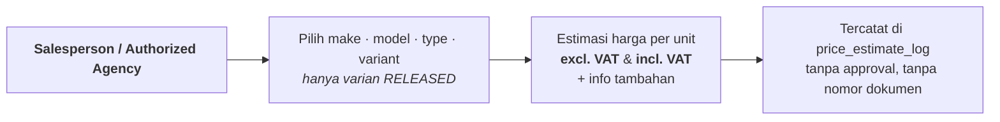
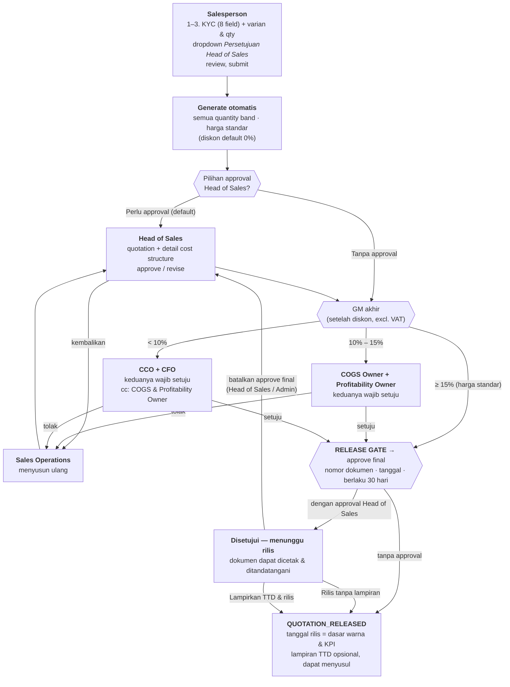
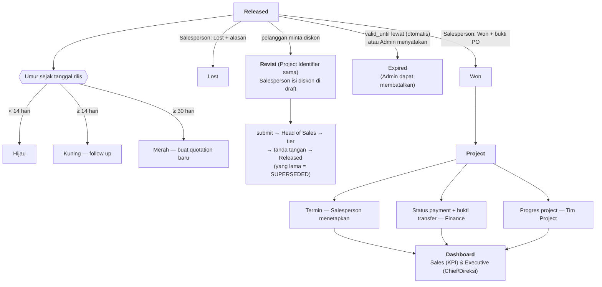

# Flow Besar & Peta Peran — Demo VKTR-PriceCore (v5.0)

Peta menyeluruh alur demo: siapa berperan apa, di titik mana mereka masuk,
dan kontrol apa yang berjalan di tiap perpindahan. Sumber: `BTEL - Cost and
Roles and Flow.xlsx` (v4.0), contoh dokumen *Cost Estimate — PT Siborong
Nusa Gemilang*, dan meeting *VKTR Req 2* (`kebutuhan_baru_v2.md`, v5.0).
Acuan: [`PRD-VKTR-PriceCore.md`](PRD-VKTR-PriceCore.md) dan
[`TECHNICAL-LOGIC-VKTR-PriceCore.md`](TECHNICAL-LOGIC-VKTR-PriceCore.md) v5.0.

Untuk langkah rinci beserta angka yang harus diketik:

- [`DEMO-FLOW-OFFICIAL-QUOTATION.md`](DEMO-FLOW-OFFICIAL-QUOTATION.md) —
  **skrip utama**: quotation 1 / 4 / 40 unit, dokumen bertanda tangan,
  diskon lewat Revisi, Won → Project → Payment → Dashboard, warna umur,
  Expired, tampilan mobile, Settings, dan lampiran data awal (Product &
  Cost Structure Maker/Checker/Releaser).
- [`DEMO-FLOW-PRICE-ESTIMATE.md`](DEMO-FLOW-PRICE-ESTIMATE.md) — Workflow A.
- [`DEMO-SCENARIO-CNY.md`](DEMO-SCENARIO-CNY.md) — skenario kurs: FOB dalam
  **CNY (RMB)**, kurs terkunci per versi cost structure, Rate Sensitivity.

---

## 1. Peran dalam Satu Halaman

Seluruh peran adalah **data di Settings → Roles & Authorities**, bukan daftar
tetap di kode — Admin dapat menambah, mengganti nama, dan mengubah
wewenangnya (PRD FR-5.6). Password seluruh akun: `PriceCore123!`.

| Peran | Akun demo | Masuk di tahap | Wewenang khas | Yang **tidak** bisa dilakukan |
|---|---|---|---|---|
| **Authorized Agency** | `agency@vktr.demo` | Price Estimate | Estimasi harga per unit excl./incl. VAT | Official Quotation; cost structure |
| **Sales Executive** | `sales.exec@vktr.demo` | Awal → akhir | Price Estimate; KYC & submit; **rilis (lampiran dokumen bertanda tangan opsional)**; **pilih "tanpa approval Head of Sales" saat membuat quotation**; **isi diskon pada draft Revisi**; Won (bukti PO) / Lost; **tetapkan termin**; dashboard KPI | Melihat cost structure/GM/tier; diskon pada draft awal |
| **Sales Lead** | `sales.lead@vktr.demo` | Awal → akhir | Sama seperti Sales Executive. Langkah *Validasi* hanya muncul bila template yang memakainya diaktifkan | Melihat cost structure |
| **Sales Operations Manager** | `salesops@vktr.demo` | Bila tier ditolak | Menyusun ulang harga/diskon, meneruskan ke Head of Sales; M/C/R scope **Sales**; dashboard semua Salesperson | Menyetujui final |
| **Head of Sales** | `headsales@vktr.demo` | Review & approve | Quotation **+ detail cost structure**, *approve/revise*, **batalkan approve final** sebelum rilis; M/C/R scope **Sales** | Merilis/melampirkan dokumen; approve GM < 15% tanpa approver tier |
| **Procurement Manager** / **Head of Proc & Ops** | `procurement@`, `headproc@` | Cost structure & Tier 2 | M/C/R scope **COGS** & **Add-Ons**; approve Tier 2; tembusan Tier 3 | Scope Margin/Sales |
| **Head of Corporate Finance** | `headfinance@vktr.demo` | Cost structure & Tier 2 | M/C/R scope **Margin**; approve Tier 2 | Scope COGS/Sales |
| **CCO** / **CFO** | `cco@`, `cfo@` | Tier 3 | Approve Tier 3 (keduanya wajib); M/C/R semua scope hanya pada skenario Deviation | Meloloskan Tier 3 sendirian |
| **Finance** *(v5.0)* | `finance@vktr.demo` | Setelah Won | **Status payment per termin** + bukti transfer | Mengubah termin; cost structure |
| **Tim Project** *(v5.0)* | `projectteam@vktr.demo` | Setelah Won | **Progres project** (tanggal, status, %) | Termin/payment; cost structure |
| **Chief / Direksi** *(v5.0)* | `chief@vktr.demo` | Pemantauan | **Dashboard executive**, Projects (baca) | Mengubah data apa pun |
| **Product Owner** | `product@vktr.demo` | Sebelum quotation | Varian produk, spesifikasi, inclusions/exclusions default | Biaya; approval harga |
| **System Admin** | `admin@vktr.demo` | Sebelum/sesudah demo | Settings; **override Expired**; audit | Ikut approval |

### Menu yang terlihat per peran (PRD FR-5.7)

Menu di luar daftar **tidak tampil** di sidebar dan halamannya menjawab
**404** bila dibuka lewat URL. Diatur di Settings → Akses Menu.

| Menu | Agency | Sales Exec / Lead | Sales Ops | Head of Sales | COGS / Profit Owner | CCO / CFO | Product Owner | Finance | Tim Project | Chief | Admin |
|---|---|---|---|---|---|---|---|---|---|---|---|
| Overview | – | ✓ | ✓ | ✓ | ✓ | ✓ | – | – | – | – | ✓ |
| **Dashboard** | – | ✓ (KPI sendiri) | ✓ | ✓ | – | – | – | – | – | ✓ | ✓ |
| Price Estimate | ✓ | ✓ | ✓ | ✓ | – | – | – | – | – | – | ✓ |
| Official Quotation | – | ✓ (milik sendiri) | ✓ | ✓ | ✓ | ✓ | – | – | – | – | ✓ |
| **Projects** | – | ✓ (milik sendiri) | ✓ | ✓ | – | – | – | ✓ | ✓ | ✓ | ✓ |
| Lifecycle & Approvals | – | – | ✓ | ✓ | ✓ | ✓ | – | – | – | – | ✓ |
| Cost Structure (M/C/R) | – | – | ✓ | ✓ | ✓ | ✓ | – | – | – | – | ✓ |
| Decision Support (DSS) | – | – | ✓ | ✓ | ✓ | ✓ | – | – | – | – | ✓ |
| Master Data & Kurs | – | – | – | – | ✓ | ✓ | – | – | – | – | ✓ |
| Product Master Data | – | – | – | – | – | – | ✓ | – | – | – | ✓ |
| Audit Trail | – | – | – | ✓ | – | ✓ (CCO, CFO) | – | – | – | – | ✓ |
| Settings | – | – | – | – | – | – | – | – | – | – | ✓ (terkunci) |
| **Halaman awal** | Price Estimate | Overview | Overview | Overview | Overview | Overview | Product Master Data | **Projects** | **Projects** | **Dashboard** | Overview |

---

## 2. Lapisan 0 — Cost Structure per Varian (Maker → Checker → Releaser)

Biaya **tidak diisi per quotation**. Setiap varian punya *price book*
berversi; setiap scope dirilis pemiliknya lewat tiga tahap. Hanya versi yang
keempat scope-nya `RELEASED` yang dipakai Price Estimate dan Official
Quotation.



- Scope berjalan **independen** (COGS dan Margin bisa bersamaan).
- Aturan default **Maker ≠ Checker** bila scope punya ≥ 2 aktor; scope Margin
  hanya satu aktor sehingga satu orang menjalankan ketiga tahap dan audit
  trail menandainya (**single-actor release**).
- **Skenario Deviation** (GM < 10%): CCO dan CFO ikut berwenang M/C/R di
  semua scope.
- Langkah memperagakannya: `DEMO-FLOW-OFFICIAL-QUOTATION.md` Lampiran A.

---

## 3. Lapisan A — Price Estimate



Estimasi = harga dasar 1 unit tanpa diskon; **tidak ada elemen cost
structure** di layar maupun respons API.

---

## 4. Lapisan B & C — Official Quotation (v5.0)



**Kontrol yang membedakan sistem ini dari spreadsheet:**

1. **Salesperson tidak pernah melihat cost structure** (juga GM/tier);
   draft awal tidak dapat diberi diskon.
2. **Quotation hanya dari cost structure yang sudah dirilis** — validasi
   biaya di hulu, sehingga semua band bisa otomatis.
3. **Tier dari GM setelah diskon**, dihitung server; **AND-join** di Tier 2 dan 3;
   tembusan Tier 3 hanya informasi; **tolak → kembali ke Sales Operations**.
4. **Approval Head of Sales dipilih per quotation** (dropdown). *Tanpa
   approval* tidak melewati tier: GM < 15% tetap butuh Owner / CCO & CFO.
   Setelah approve, **Salesperson merilis**; **lampiran dokumen bertanda
   tangan opsional** (sebelum atau sesudah rilis); approve final dapat
   dibatalkan sebelum rilis.
5. **Delivery Service** dinilai **atau** dinyatakan *Exclusion — At cost*.

| GM akhir | Tier | Keputusan | Bila ditolak |
|---|---|---|---|
| ≥ 15% | 1 | Head of Sales | — |
| 10% – < 15% | 2 | COGS Owner **dan** Profitability Owner | Kembali ke Sales Operations |
| < 10% | 3 | CCO **dan** CFO (cc COGS & Profitability Owner) | Kembali ke Sales Operations |

**Quantity band (konfigurasi v5.0):** semua band **Otomatis** dengan diskon
default **0%** (sebelumnya 2–5 unit 2% dan 6–9 unit 3%), sehingga rilis awal
= harga standar; diskon hanya lewat Revisi (§5).

### Workflow Template Catalog — satu workflow di seed, katalog tetap dapat diisi

Mesin tetap mendukung ±30 template (qualifier statis: segmen, industri,
hubungan, lini bisnis, qty, estimasi nilai, blacklist). Pada go-live v5.0
hanya **Standard** yang ada di seed (migrasi 0021 menghapus lima template contoh).
Workflow baru ditambahkan di Settings → Workflow (**Tambah workflow** atau
**Duplikat**). Tabel berikut hanya **contoh definisi** yang pernah disediakan.

| Template contoh (kode) | Status | Langkah setelah KYC | Tier margin |
|---|---|---|---|
| Standard (`OQ-STANDARD`) | **Aktif** (versi 2) | Generate (otomatis) → Review & Rilis | Global |
| Customer Blacklist (`OQ-BLACKLIST`) | Dihapus dari seed | Validasi → Persetujuan Pricing Committee → Generate → Review | Semua tier CCO + CFO |
| Relasi Khusus (`OQ-RELASI-KHUSUS`) | Dihapus dari seed | Generate → Review | GM < 15% langsung CCO + CFO |
| Nilai Besar ≥ Rp 50 M (`OQ-NILAI-BESAR`) | Dihapus dari seed | Validasi → Kelayakan deal (Pricing Committee) → Generate → Review | Global |
| B2G Pemerintah (`OQ-B2G`) | Dihapus dari seed | Validasi → Verifikasi tender (Head of Sales) → Generate → Review | Setiap tier sampai CCO + CFO |
| Industri Tambang & Perkebunan (`OQ-INDUSTRI-BERAT`) | Dihapus dari seed | Validasi → Generate → Review COGS Owner → Review | Global |

Hanya template yang aktif dipertimbangkan saat submit; tanpa yang cocok,
template dasar dipakai. Template menyimpan perubahan sebagai **versi baru**;
quotation berjalan memakai salinan langkahnya. Tier tidak dapat dihapus oleh
template. Demo variasi: `DEMO-FLOW-OFFICIAL-QUOTATION.md` B9.

---

## 5. Setelah Rilis — Diskon, Hasil, Project, Dashboard



- **Negosiasi tidak membuka mesin persetujuan baru**: setiap perubahan setelah
  rilis menjadi Revisi, yang kembali melewati Head of Sales → tier →
  dokumen bertanda tangan. Salesperson mengisi diskon **hanya pada draft
  revisi**.
- **Won/Lost manual** oleh Salesperson (Won wajib bukti PO, Lost wajib
  alasan). **Expired otomatis**, dengan override Admin (alasan tercatat).
- Won, Lost, dan Expired menghentikan penghitungan warna. Semua input project
  **manual**; tanpa integrasi SAP/bank/aplikasi project.

---

## 6. Dokumen Keluaran — Preview, Cetak, Tanda Tangan

Format mengikuti contoh *Cost Estimate — PT Siborong Nusa Gemilang*:

| Halaman | Isi |
|---|---|
| 1 | Header VKTR · judul "COST ESTIMATE" · Number · tanggal & Expiry Date · **To** (dari KYC) · Disclaimer · Sales/Account Person · Product · Prepared By · tabel Quantity/Description/Unit/Total · Inclusions · **Exclusions — At cost** · Total · Special Notes · blok tanda tangan |
| 2–4 | **Specification** dari Product Master Data |

- **Preview draft** bertanda watermark **"DRAFT — NOT FOR CUSTOMER"**, tanpa
  nomor resmi.
- Setelah **approve final**, dokumen sudah **bernomor dan bertanggal**; dicetak
  **tanpa watermark** (*Cetak untuk ditandatangani*) supaya dapat
  ditandatangani bila diperlukan. Resmi dan siap dikirim setelah quotation
  dirilis (dengan atau tanpa lampiran bertanda tangan).
- Versi lama bertanda **SUPERSEDED**, kedaluwarsa **EXPIRED**.
- **Cost Structure Sheet** (*Highly Confidential*) dicetak terpisah, hanya
  untuk Sales Operations, Head of Sales, pemilik scope, CCO/CFO.
- Berkas (dokumen bertanda tangan, PO, bukti transfer) disimpan di bucket
  privat dan dibuka lewat tautan sementara.

---

## 7. Cost Structure — Empat Scope

| Scope | Item | Pemilik |
|---|---|---|
| **COGS** | FOB Price in CNY, FOB Price in IDR (*otomatis*), Freight and Insurance, Custom Duties, Port Handling & PDI, Carrosserie Allocation, Assembly Cost, Local Parts, Accessories, Telematics, Warehousing and Storage, Warranty Cost, Initial Energy Injection, Administrative Cost | COGS Owner |
| **Add-Ons** | **STNK**, KEUR, **Insurance**, Processing Service, Delivery Service *(nilai atau "At cost")*, Additional | COGS Owner |
| **Margin** (Profitability) | VKTS Profit Before Tax, VKTS Margin, VKTR Profit Before Financing Cost, Financing Cost, VKTR Margin After Financing Cost | Profitability Owner |
| **Sales** | Incentive Internal, Incentive External, Sales Processing Cost, Agency Fee | Sales Pricing Owner |

STNK & Insurance adalah **Add-Ons**; kelompok Sales dimiliki Head of Sales /
Sales Operations Manager.

---

## 8. Peta Modul → Peran → Kontrol

| Modul | Peran utama | Kontrol yang dibuktikan |
|---|---|---|
| Settings: Roles, Scope Authority, Workflow, Tier & Band, Umum | System Admin | Role, wewenang, workflow, ambang warna diatur tanpa ubah kode |
| Product Master Data | Product Owner | Varian + spesifikasi + inclusions/exclusions menjadi isi dokumen |
| Cost Structure M/C/R | COGS / Profitability / Sales Pricing Owner | Tidak ada harga dari versi yang belum dirilis; pemisahan Maker/Checker |
| Price Estimate | Salesperson, Authorized Agency | Harga excl./incl. VAT seketika, nol cost structure |
| KYC | Salesperson | Submit ditolak bila field wajib kosong |
| Official Quotation | Salesperson → Head of Sales (opsional) | Satu workflow; harga standar; approve → rilis; lampiran TTD opsional; dropdown tanpa approval |
| Tier 15% / 10% | Owners / CCO+CFO | AND-join; tolak kembali ke Sales Ops; tembusan Tier 3 |
| Release Gate | Sistem | Mandatory, Delivery "At cost", kurs |
| Dokumen & cetak | Sesuai hak | Cost Estimate; cetak untuk tanda tangan; cetak ulang identik |
| Revisi (diskon) | Salesperson | Diskon hanya di draft revisi; lama `SUPERSEDED` |
| Hasil & umur quotation | Salesperson, Admin | Won (PO) / Lost; badge hijau/kuning/merah; Expired + override |
| **Projects** | Salesperson, Finance, Tim Project | Termin / payment / progres dipisah per peran |
| **Dashboard** | Salesperson, Head of Sales, Chief | KPI pribadi dan ringkasan executive tanpa cost structure |
| Multi-Currency + Rate Sensitivity | COGS Owner, Sales Ops | Kurs dikunci per versi; banner melewati ambang |
| Duplicate/Fraud Guard | Salesperson | Maks. 1 quotation/hari per customer + varian |
| Observability & Audit | Semua | Antrean, Kanban per status, audit *append-only* |
| **UI responsif** | Semua | Drawer, kartu/tabel adaptif, Kanban geser |
| DSS | Head of Sales, CCO/CFO | What-If + tier yang akan berlaku |

---

## 9. Perubahan v5.0 Terhadap v4.1

| Aspek | v4.1 | v5.0 |
|---|---|---|
| Workflow aktif | Katalog 6 template | **Satu** (`OQ-STANDARD`); template contoh lain dihapus dari seed |
| Sebelum Head of Sales | Validasi Sales Lead; Generate (manual band 10+) | Tidak ada antrean; Generate otomatis, diskon default 0% |
| Rilis | Head of Sales merilis langsung | **Approve → Disetujui (menunggu rilis) → Salesperson merilis, lampiran TTD opsional**; **dropdown *Tanpa approval Head of Sales* → langsung rilis (tier tetap berlaku)**; approve final dapat dibatalkan |
| Diskon | Sales Ops / Head of Sales | Tetap Revisi + tier; **Salesperson mengisi diskon pada draft Revisi** |
| Hasil | WON/LOST, URL salinan opsional | Won (**wajib bukti PO**) / Lost (alasan) manual |
| Kedaluwarsa | Otomatis | **Tetap otomatis**; Admin dapat menyatakan/membatalkan; + warna kuning 14 / merah 30 hari dari tanggal rilis |
| Setelah Won | Selesai | **Project**: termin (Salesperson), payment (Finance), progres (Tim Project) |
| Dashboard | Overview, Lifecycle, DSS | + **Dashboard Sales** dan **Executive** |
| Peran | 12 | + **Finance**, **Tim Project**, **Chief / Direksi** |
| Tampilan | Desktop | **Responsif** (handphone, iPad) |
| Integrasi | Di-skip | Tetap di-skip (SAP/aplikasi project ditunda) |

---

## 10. Menyiapkan & Mengulang Demo

Prasyarat sekali: migrasi `0018` lalu `0019` (Supabase), lalu
`npm run seed:demo` (membuat 15 akun termasuk Finance, Tim Project, Chief).

```bash
npm run reset:demo      # kembalikan ke kondisi sebelum demo
```

`reset:demo` **menghapus semua quotation** (juga project, termin, progres,
dan berkas di bucket), log Price Estimate, dan audit log; mengembalikan
cost structure v1 dan quotation historis berikut project dari yang Won; bila
kurs CNY/IDR diubah saat demo, menambahkan baris kurs 2.600 baru. Settings
(termasuk workflow yang Anda tambahkan di B9), master data, dan akun demo
tidak disentuh — hapus/nonaktifkan lagi workflow tambahan dari B9 bila tidak dipakai.
